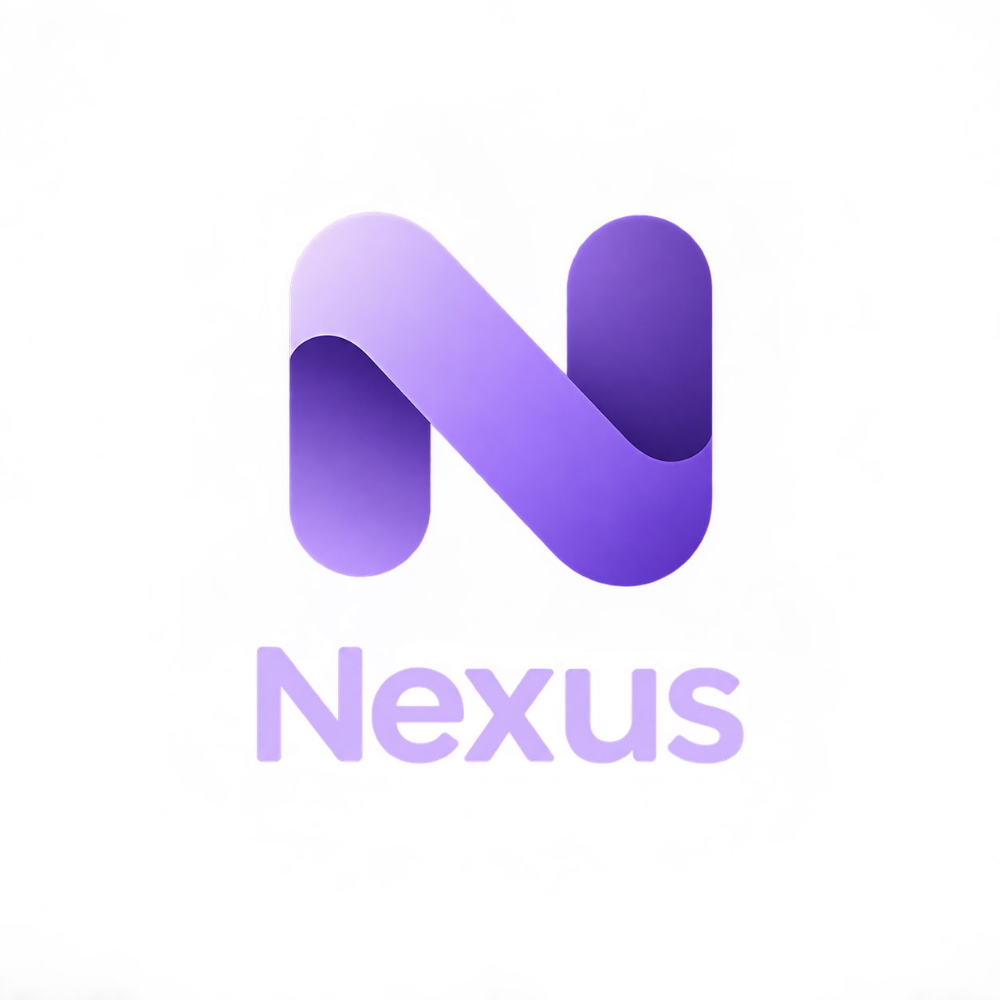
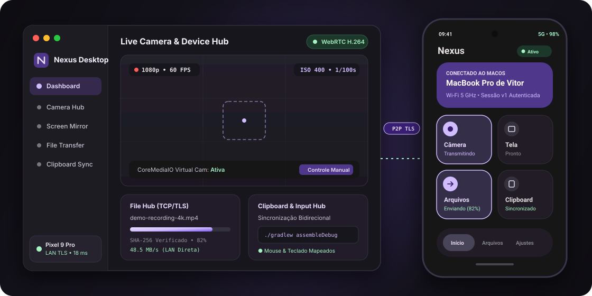
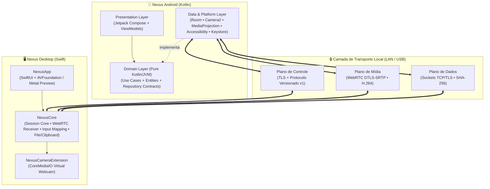

<div align="center">

  

  **Transforme seu smartphone Android em uma extensão nativa, segura e de baixa latência para o seu Mac.**

  <p align="center">
    <a href="https://github.com/AnxeLOo/project-nexus/actions"></a>
    <a href="protocol/README.md"></a>
    <a href="android/README.md"></a>
    <a href="macos/README.md"></a>
    <a href="docs/testing/README.md"></a>
    <a href="#license"></a>
  </p>

  <p align="center">
    <a href="#-about">About</a> •
    <a href="#-features">Features</a> •
    <a href="#-tech-stack">Tech Stack</a> •
    <a href="#-architecture">Architecture</a> •
    <a href="#-getting-started">Getting Started</a> •
    <a href="docs/README.md">Docs</a> •
    <a href="#-author">Author</a>
  </p>

</div>

---

## 📖 About

Integrar um smartphone **Android** ao ecossistema **macOS** historicamente exige combinar múltiplas ferramentas fragmentadas, lentas ou dependentes de servidores na nuvem. O **Nexus** foi construído para eliminar esse atrito, unificando **streaming de câmera profissional, espelhamento de tela com controle remoto, transferência de arquivos e sincronização de área de transferência** em uma única plataforma nativa.

O sistema é composto por dois clientes complementares — **Nexus Android** (Kotlin / Jetpack Compose) e **Nexus Desktop** (Swift / SwiftUI) — que se comunicam diretamente ponto a ponto (P2P) via **Rede Local (Wi-Fi LAN), Wi-Fi Direct ou USB**.

### Principais Diferenciais
- **Privacidade e Operação 100% Local:** Nenhum vídeo, arquivo ou texto da área de transferência passa por servidores externos. Toda a comunicação ocorre diretamente entre os dispositivos ([ADR-009](docs/decisions/ADR-009-sem-servidor-de-midia-obrigatorio.md)).
- **Três Planos Lógicos Isolados:** Separação estrita entre **Plano de Controle** (TLS), **Plano de Mídia** (WebRTC DTLS-SRTP) e **Plano de Dados** (TCP/TLS), garantindo que transferências de arquivos pesados nunca causem engasgos ou aumento de latência no vídeo.
- **Pipeline de Vídeo Acelerado por Hardware:** Captura direta via `Camera2` e `MediaProjection` acoplada ao `MediaCodec` (H.264) e renderização nativa via `AVFoundation` / `Metal` e `CoreMediaIO` no macOS.

### Demonstração Visual

<div align="center">
  
  <p><em>Visão integrada do cliente <strong>Nexus Desktop (macOS)</strong> e do aplicativo <strong>Nexus Android (Material Design 3)</strong> operando em sessão local autenticada.</em></p>
</div>

> [!TIP]
> **Explore os Protótipos Interativos de UI:** Você pode abrir os protótipos navegáveis diretamente no navegador:
> - 🖥️ **macOS Desktop:** [`docs/prototypes/macos/home.html`](docs/prototypes/macos/home.html)
> - 📱 **Android Material You:** [`Dashboard`](docs/prototypes/android/home.html) • [`Transferências`](docs/prototypes/android/transfers.html) • [`Dispositivos`](docs/prototypes/android/devices.html) • [`Configurações`](docs/prototypes/android/config.html)

---

## ✨ Features

- 📷 **Camera Hub (Webcam Pro & Streaming)**
  - Transforma a câmera do smartphone em fonte de vídeo de alta definição (1080p@30fps / 720p@60fps) com meta de latência P95 < 150 ms.
  - Controles manuais em tempo real baseados nas capacidades reais do sensor (`Camera2`): ISO, velocidade do obturador, compensação de exposição, lentes/zoom e flash/tocha.
  - Integração nativa com o macOS via System Extension (`CoreMediaIO`) para uso em FaceTime, Zoom, Google Meet e OBS Studio.
- 🖥️ **Screen Hub (Espelhamento & Controle Remoto)**
  - Captura e transmissão fluida da tela do Android via `MediaProjection` e WebRTC.
  - Mapeamento preciso de coordenadas de mouse, trackpad e teclado do Mac para gestos e eventos autorizados no Android via `AccessibilityService`.
- 📁 **File Hub (Transferência Bidirecional Confiável)**
  - Envio e recebimento de arquivos em blocos sobre sockets `TCP/TLS` dedicados.
  - Verificação criptográfica de integridade ponta a ponta (`SHA-256`), escrita segura em arquivo temporário, acompanhamento de progresso reativo (`Flow`) e cancelamento a qualquer instante.
- 📋 **Clipboard Hub (Área de Transferência Compartilhada)**
  - Sincronização rápida de texto com consentimento explícito por dispositivo, limites de payload e prevenção de loops infinitos de sincronização.
- 🔐 **Device Hub (Descoberta, Pareamento & Sessão)**
  - Descoberta automática na rede local via `mDNS / DNS-SD` (Bonjour / Android NSD).
  - Pareamento autenticado por criptografia de chave pública (QR Code / código de confirmação), armazenamento seguro no `Android Keystore` / `macOS Keychain`, heartbeat contínuo e reconexão automática com *exponential backoff*.

---

## 🛠️ Tech Stack

O ecossistema tecnológico do **Nexus** é dividido por camadas de responsabilidade entre os dois sistemas nativos:

### Frontend (Mobile & Desktop UI)
- **Android UI:** [Jetpack Compose](https://developer.android.com/compose), **Material Design 3** (`NexusTheme` com suporte dinâmico a tema claro/escuro), Navigation Compose e Lifecycle ViewModels.
- **macOS UI:** **SwiftUI**, **AVFoundation** e **Metal** (renderização de vídeo acelerada por GPU).

### Backend Local (Core Services, Rede, Protocolo & Mídia)
- **Linguagens & Concorrência:** **Kotlin 2.0** (`Coroutines` & `StateFlow`/`SharedFlow`) no Android e **Swift** (`Structured Concurrency`) no macOS.
- **Protocolo de Controle:** Contrato próprio versionado em JSON / Protocol Buffers (`kotlinx.serialization` e Swift `Codable`) sobre canal persistente **TLS** ([`protocol/`](protocol/README.md)).
- **Streaming de Mídia:** **WebRTC** (`DTLS-SRTP`) com codificação de hardware **H.264** (`MediaCodec`).
- **Transporte de Dados & Descoberta:** Sockets **TCP/TLS**, **mDNS / DNS-SD** (Android NSD e Apple `Network.framework`).
- **Integrações de Sistema:** Android `Camera2`, `MediaProjection`, `AccessibilityService` e macOS `CoreMediaIO` (Camera Extension).

### Banco de Dados & Segurança
- **Persistência Local (Android):** **Room Persistence Library** (SQLite) para dispositivos pareados, perfis de câmera, histórico de transferências e preferências globais.
- **Gestão de Credenciais & Chaves:** **Android Keystore System** e **macOS Keychain** para proteção de chaves privadas e identidades de dispositivos confiáveis.

### Infraestrutura, Build & Qualidade
- **Arquitetura de Repositório:** Monorepositório integrando `android/`, `macos/`, `protocol/` e `docs/`.
- **Build System & DI:** **Gradle Kotlin DSL** com *Version Catalogs* (`libs.versions.toml`), **Dagger Hilt** + **KSP**, **R8 / ProGuard**.
- **Testes & CI/CD:** **JUnit 4**, `kotlinx-coroutines-test`, módulo dedicado de Fakes/Fixtures (`:core:testing`) e pipelines de validação via **GitHub Actions**.

---

## 🏗️ Architecture

O projeto aplica **Clean Architecture + MVVM** combinada aos princípios **SOLID** e **Domain-Driven Design (DDD)** na modelagem das regras de negócio:

1. **Independência de Frameworks no Domínio:** Os módulos `:core:model` e `:core:domain` são escritos em **Kotlin/JVM puro** (`org.jetbrains.kotlin.jvm`), sem qualquer dependência do SDK Android, Room ou WebRTC ([ADR-002](docs/decisions/ADR-002-clean-architecture-mvvm.md)).
2. **Inversão de Dependência (DIP):** Os módulos de infraestrutura e plataforma (`:core:database`, `:core:network`, `:platform:camera2`, `:platform:webrtc`, etc.) implementam contratos definidos exclusivamente na camada de domínio.
3. **Máquina de Estados Centralizada:** Uma única fonte de verdade coordena as transições de sessão (`Disconnected` → `Discovering` → `Pairing` → `Connecting` → `Connected` ↔ `Reconnecting`).



### Estrutura do Monorepositório

```text
project-nexus/
├── android/          # Aplicativo nativo Android multimódulo (:app, :core:*, :feature:*, :platform:*)
├── macos/            # Cliente desktop macOS (NexusApp, NexusCore, NexusCameraExtension, NexusTests)
├── protocol/         # Single Source of Truth dos schemas e exemplos de payloads do protocolo
├── docs/             # Documentação arquitetural completa, ADRs, roadmap e protótipos HTML
└── scripts/          # Scripts utilitários de automação e configuração do projeto
```

📚 **Documentação Arquitetural Detalhada em [`/docs`](docs/README.md):**
- [Visão Geral do Produto e Premissas Técnicas](docs/product-overview.md)
- [Arquitetura do Sistema e Diagramas de Comunicação](docs/architecture/README.md)
- [Modelagem de Entidades e Domínio](docs/architecture/data-model.md)
- [Componentes Críticos e Pipelines (Vídeo, Rede e CoreMediaIO)](docs/architecture/components-and-pipelines.md)
- [Arquitetura Android, Módulos Gradle e Concorrência](docs/architecture/android-architecture.md)
- [Especificação do Protocolo de Comunicação](docs/protocol/README.md)
- [Catálogo de Decisões Arquiteturais (ADR-001 a ADR-010)](docs/decisions/README.md)
- [Estratégia de Testes](docs/testing/README.md) • [Build & CI/CD](docs/build-and-release.md) • [Roadmap (Fases 1–3)](docs/roadmap.md)

---

## 🚀 Getting Started

Siga as instruções abaixo para clonar, compilar e executar o projeto localmente em sua máquina de desenvolvimento.

### Pré-requisitos

- **Git** instalado.
- **JDK 17** ou **JDK 21** configurado na variável de ambiente `JAVA_HOME`.
- **Android SDK** (`Android SDK Platform 35` e `Build-Tools 35.0.0`) instalado via **Android Studio Ladybug (2024.2.1)+** ou `sdkmanager`.
- Dispositivo físico ou emulador com **Android 10 (API 29)** ou superior.
- *(Opcional — para os módulos macOS)* **macOS 13+** com **Xcode 15+** instalado.

### Passos de Instalação

1. **Clone o repositório:**
   ```bash
   git clone https://github.com/AnxeLOo/project-nexus.git
   cd project-nexus
   ```

2. **Configure o caminho do Android SDK** (caso a variável `ANDROID_HOME` não esteja definida globalmente no seu shell):
   ```bash
   echo "sdk.dir=$HOME/Library/Android/sdk" > android/local.properties
   ```

3. **Compile os artefatos do aplicativo Android (Debug e Release):**
   ```bash
   cd android
   ./gradlew assembleDebug assembleRelease
   ```

4. **Execute a suíte de testes unitários (Domínio em JVM puro e ViewModels):**
   ```bash
   ./gradlew test
   ```

5. **Instale e execute a variante Debug em um dispositivo ou emulador conectado:**
   ```bash
   ./gradlew installDebug
   ```

> Para instruções avançadas sobre variantes de build, módulos Gradle e temas Material 3, consulte o guia dedicado em [`android/README.md`](android/README.md).

---

## 👤 Author

Desenvolvido por **Ângelo Barbosa** (**@AnxeLOo**).

- 🐙 **GitHub:** [@AnxeLOo](https://github.com/AnxeLOo)
- ✉️ **E-mail:** [angelobdasilva.dev@gmail.com](mailto:angelobdasilva.dev@gmail.com)
- 📦 **Repositório:** [github.com/AnxeLOo/project-nexus](https://github.com/AnxeLOo/project-nexus)
